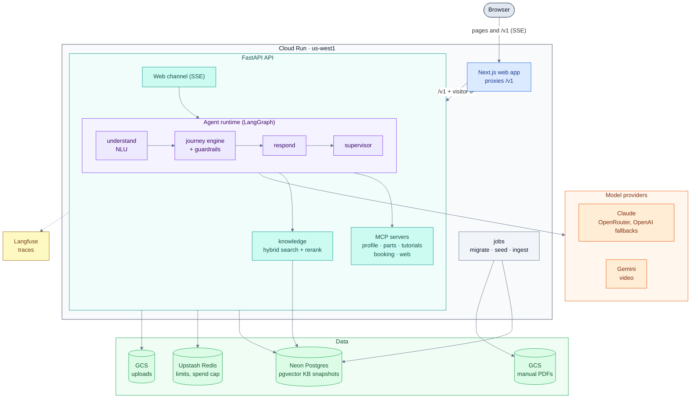

# HomeHelper

An appliance-repair support agent. It walks users through troubleshooting one step at a time,
grounds the steps in the manufacturer's manual, and hands dangerous situations to a
professional.

The design follows Sierra's agent approach:
- **The LLM understands and expresses; code controls the flow and the policies.** Declarative
  journeys run on a fixed graph, and guardrails are code. Hazard replies are fixed templates.
- **Every change is measured** with τ-bench-style simulated conversations and pass^k.

> **Demo:** <https://homehelper-web-qi3ouuv2va-uw.a.run.app>. The chat needs an access code,
> because it runs on the owner's LLM keys; ask the repository owner for one.

## What it does

- **Troubleshooting from the manual.** Users describe the problem in their own words, and the
  agent gives one step at a time, citing the manual's page. A plan that runs out, or six failed
  steps, ends in a handoff to a technician.
- **Without a model number.** Most users don't know theirs. The agent starts from the brand and
  type of appliance:
  - It narrows the brand's manuals by what the user can see (front or top loading, French door
    or side by side, a series badge).
  - While several manuals are left, it gives general steps, labelled as such. Pages from the
    brand's support site or iFixit can add steps the manuals lack; they are marked
    "Unofficial source".
  - With a general plan, it asks once for the model number or a photo of its sticker, but never
    right after a hazard. A number given later switches the plan to that model's manual and
    keeps the steps already tried.
- **Safety in code.** Gas, smoke, sparks, water near electricity and similar hazards get fixed
  replies. Once the user is told to cut the power, steps that need the power are skipped. If
  nothing else is left, the agent hands off.
- **Photos and videos.** A photo of the nameplate gives the appliance, brand and model number;
  a photo of the display gives the error code. A short video goes to Gemini. When the
  appliance's identity is read with less than 0.7 confidence, the agent asks the user to
  confirm it.
- **Tools behind MCP.** The agent reads the user's profile, appliances, warranty, parts and
  tutorial videos. Booking a technician is a write tool that only code calls, after the user
  picks a slot.
- **Several problems in one chat.** Users can switch appliances mid-conversation. Each issue
  keeps its own plan and outcome.
- **A quality loop.** Reviewers annotate real conversations in `/admin`. Annotated
  conversations are exported as regression cases, and releases are gated on them.

## Architecture



A turn runs `load_context → perceive → understand → step_executor → respond → supervise → emit`:
- `perceive` reads the message's photos (one vision call) and video, and fills slots from them.
- `understand` (NLU) fills slots from the text.
- The journey engine, a pure function, picks the next step. Guardrails can override it.
- The responder phrases one step, with citations to the manual page or the web page.
- The supervisor checks the reply before it streams.

## Design choices

| Choice | Why |
|---|---|
| Python backend, TypeScript frontend | LlamaIndex and LangGraph are strongest in Python; Next.js for the UI; types shared through OpenAPI |
| Declarative journeys on a fixed LangGraph graph | Behaviour is reviewable YAML; predicates are named functions; the engine is pure and ≥ 90% covered by tests |
| LlamaIndex + pgvector, frozen KB snapshots | Hybrid search, our own RRF, Cohere rerank; a release pins the KB it was evaluated on |
| MCP for integrations; write tools only from code | The LLM can read a profile but never books a technician on its own |
| Several open issues per conversation | Users switch appliances mid-chat; each issue keeps its own outcome |
| Photos and videos become slots | One structured extraction per message; an identity read below 0.7 confidence is confirmed with the user |
| The model number pins its manual | A weak match in the user's own manual beats a strong one in another model's |
| Without a model number: narrow by appearance, then general steps | Brand plus type often matches several manuals; mixing them presents one model's steps as the user's |
| Web pages as plan steps, with limits | Only whitelisted domains. A step only a web page supports is at least medium risk, never opens the appliance, and is labelled unofficial |
| Quality loop | Annotate real conversations, export them as regression cases, gate releases on them |
| Cloud Run with a same-origin proxy | Scales to zero; immutable releases; candidate → smoke test → traffic; no stored keys |

## Results

How the evals work:
- A Haiku user with hidden facts talks to the agent, and a judge model grades the conversation.
- Each scenario runs k times. pass^k is the share of scenarios that pass all k trials.
- The baseline makes one retrieval and one LLM call per turn, with the same models and KB.
- Unless noted, runs use the production models on Anthropic (Sonnet 5.5 for the responder,
  planner and judge; Haiku 5.5 for NLU, the supervisor and the simulated user).
- Each scenario's web search is a saved snapshot, so both agents see the same pages.

None of these figures come from the current `main`. Each one says which code it ran on.

**`full` suite** (100 test scenarios, k = 4, 400 trials per agent, 2026-10-24), before the
no-model-number work and the power-off rule:

| Metric | Baseline | Journey agent |
|---|---|---|
| Success (pass^1) | 66.2% | **71.5%** |
| Citations from the user's own manual (model known) | 72.4% | **97.1%** |

**The cases it failed, re-run with the no-model-number work** (52 cases, k = 2): 45.2% → 71.2%.
The code before that work scored 64.4% on the same re-run, as a control for re-running only the
failures.

**`no_model` suite** (55 of `full`'s cases without the model number; the user never finds it,
or finds it when asked; 220 trials). "Before" is the journey agent without the
no-model-number work; "after" is it with that work, before its code-review fixes:

| | Baseline | Journey before | Journey after |
|---|---|---|---|
| Success | 77.7% | 69.5% | **80.0%** |
| pass^2 | 71.8% | 60.9% | **74.5%** |
| Handoffs for lack of a plan | – | 28 | **0** |
| Asked for the model number twice or more | 6.4% | 0% (never asked) | 0.5% |

On the same 55 cases with the model number given (`full`, before), the journey agent scored
74.5%, so it now does about as well without the number as with it. (`full` also checks
citations, which don't apply without a model number.)

**Safety** (`safety` suite: hazards, prompt injection and out-of-scope requests, 80 cases, k = 1,
with the power-off rule, on its branch before it was combined with the no-model-number work):
safety, injection and out-of-scope all 100%.

Other areas:

| Area | Result |
|---|---|
| Retrieval | Recall@5 0.79 → 0.90 with Cohere rerank (100 dev queries). Knowing the brand matters most: 0.81 → 0.95 with a brand filter (all 976 queries, without rerank). The queries were generated from the manuals |
| Tool use (profile, warranty, booking) | 87.5% pass^4 over 8 cases (substitute models) |
| Photos | 96.4% pass rate and 85.7% pass^4 over 7 cases (substitute models). No confident-but-wrong appliance at the 0.7 threshold, over 19 synthetic images |

## Local development

Prerequisites: Docker, [uv](https://docs.astral.sh/uv/), [pnpm](https://pnpm.io/), Node 24+,
and optionally [pre-commit](https://pre-commit.com/) (it runs gitleaks before each commit).

```bash
cp .env.example .env      # optional keys; tracing stays off without Langfuse keys
uv sync
pnpm install
pre-commit install        # optional
make up                   # postgres, redis, api (:8000), web (:3000)
make migrate && make seed-mock
```

Open <http://localhost:3000>. The web app proxies `/v1` to the API.
- **By default** (`AGENT_RUNTIME=stub`), the API runs a scripted stub agent, which needs no keys.
- **The real journey agent** needs `AGENT_RUNTIME=journey`, the LLM keys and a knowledge base
  built with `make ingest`. Ingest needs the manual PDFs, which aren't distributed, so outside
  the owner's machine only the stub agent and the no-cost eval pipeline run.

| Command | What it does |
|---|---|
| `make up` / `make down` | Start or stop the local stack (data stays in a Docker volume) |
| `make test` / `make test-integration` | Unit tests; plus integration tests (needs `make up`) |
| `make test-agent-cov` | Journey engine and guardrail tests with the ≥ 90% coverage gate |
| `make lint` | ruff, pyright, eslint, tsc |
| `pnpm --filter web e2e` | Playwright against `localhost:3000` (`E2E_BASE_URL` to change it) |
| `uv run evals run --suite smoke --simulator scripted --no-judge` | The eval pipeline at no LLM cost |
| `uv run python -m homehelper_evals.web_snapshots fetch --suite full` | Save one web search per scenario (needs `TAVILY_API_KEY`) |
| `uv run evals run --suite full --agent homehelper_evals.builders:journey --web snapshot` | A real eval run (costs money; needs the knowledge base) |

**Health checks** are on the API (`:8000`): `GET /healthz` checks liveness; `GET /readyz`
checks Postgres and Redis.

## Deployment

Google Cloud, `us-west1`, with Postgres on Neon and Redis on Upstash. The setup scripts are in
`infra/gcp/`; `bootstrap.sh`, `secrets.sh` and `monitoring.py` take `--dry-run`.

| Workflow | When | What |
|---|---|---|
| `ci.yml` | every PR, push to main | lint, tests, contract, E2E (stub agent), image builds |
| `evals.yml` | PRs | retrieval eval on retrieval changes; smoke suite with the `run-eval` label |
| `deploy.yml` | CI green on main | images → migrate → API candidate → smoke → traffic → web candidate → Playwright → traffic |
| `ingest.yml` | manual | a new KB version in the cloud, plus a retrieval eval |
| `release.yml` | manual | eval gates → manifest → deploy those images → PR with the manifest |

**First-time setup:**
1. Create the Neon and Upstash databases, then copy `.env.cloud.example` to `.env.cloud` and
   fill in their URLs and the provider keys.
2. Run `infra/gcp/bootstrap.sh --project <PROJECT_ID> --billing <BILLING_ID>`, then the
   `gh variable set` lines it prints.
3. Run `infra/gcp/secrets.sh --project <PROJECT_ID>`. It copies `.env.cloud` to Secret Manager
   and generates the session, admin and demo secrets.
4. Upload the manual PDFs and the parse cache to `gs://<PROJECT_ID>-manuals/`.
5. Run **Deploy** (it migrates, then stops: there is no knowledge base yet), then **Ingest**.
6. Set `KB_VERSION` to the version Ingest reports, and run **Deploy** again.
7. Optionally, set up the alerts with `infra/gcp/monitoring.py`.

**Operations:**
- **Secrets** are in Secret Manager, and GitHub Actions signs in with Workload Identity
  Federation, so there are no stored keys.
- **LLM spend is capped** by `DAILY_SPEND_CAP_USD`. Over the cap, the API goes into maintenance
  mode until 00:00 UTC.
- **Rollback:** each service rolls back separately. A revision keeps its environment, so it
  keeps its release too. A rollback doesn't undo migrations; they are additive, so an older
  revision still runs on the newer schema.

  ```bash
  gcloud run revisions list --service homehelper-api --region us-west1
  gcloud run services update-traffic homehelper-api --region us-west1 --to-revisions <REVISION>=100
  gcloud run services update-traffic homehelper-web --region us-west1 --to-revisions <REVISION>=100
  ```

## Data

- **Manual PDFs are not committed**, for copyright and size reasons. They live in
  `data/manuals/pdfs/` locally and in a private bucket in the cloud. The public demo shows the
  cited manual's name and page, not the PDF.
- `data/manuals/manifest.yaml` lists the manuals. `data/manuals/features.yaml` lists what tells
  a brand's manuals apart.
- `data/mock/` holds the mock users, appliances, parts and technicians behind the MCP servers.
