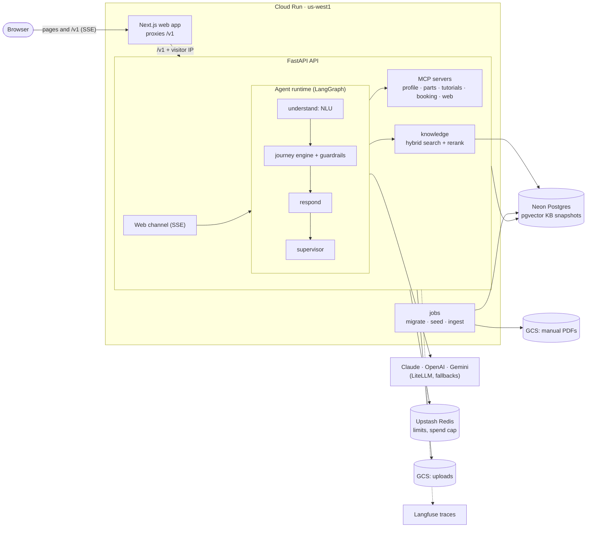

# HomeHelper

An appliance-repair support agent. It walks users through troubleshooting one step at a time,
grounds every step in the manufacturer's manual, and hands dangerous situations to a
professional.

The design follows Sierra's agent approach:
- **The LLM understands and expresses; code controls the flow and the policies.** Declarative
  journeys run on a fixed graph, and guardrails are code. Hazard replies are fixed templates.
- **Every change is measured** with τ-bench-style simulated conversations and pass^k.

> **Demo:** the live link and a demo GIF are added after the first cloud deploy
> ([`docs/deploy.md`](docs/deploy.md)). The chat needs an access code, because it runs on the
> owner's LLM keys; ask for one.

## Architecture



A turn runs `load_context → perceive → understand → step_executor → respond → supervise → emit`:
- NLU fills slots from the message (and from photos or videos).
- The journey engine, a pure function, picks the next step. Guardrails can override it.
- The responder phrases one step, with citations to the manual page.
- The supervisor checks the reply before it streams.

## Design choices

| Choice | Why | ADR |
|---|---|---|
| Python backend, TypeScript frontend | LlamaIndex and LangGraph are strongest in Python; Next.js for the UI; types shared through OpenAPI | [001](docs/adr/001-python-backend-typescript-frontend.md) |
| Declarative journeys on a fixed LangGraph graph | Behaviour is reviewable YAML; predicates are named functions; the engine is pure and ≥ 90% covered by tests | [002](docs/adr/002-declarative-journeys-on-langgraph.md) |
| LlamaIndex + pgvector, frozen KB snapshots | Hybrid search, our own RRF, Cohere rerank; a release pins the KB it was evaluated on | [003](docs/adr/003-llamaindex-and-pgvector.md) |
| MCP for integrations; write tools only from code | The LLM can read a profile but never books a technician on its own | [004](docs/adr/004-mcp-for-external-integrations.md), [006](docs/adr/006-mcp-sdk-1x-and-stateless-mounting.md), [008](docs/adr/008-agent-mcp-client.md) |
| Several open issues per conversation | Users switch appliances mid-chat; each issue keeps its own outcome | [007](docs/adr/007-multi-issue-tracking.md) |
| Photos and videos become slots | One structured extraction; low confidence asks the user to confirm | [009](docs/adr/009-multimodal-input.md) |
| The model number pins its manual | A weak match in the user's own manual beats a strong one in another model's | [012](docs/adr/012-keep-the-model-numbers-manual.md) |
| Quality loop | Annotate real conversations, export them as regression cases, gate releases on them | [010](docs/adr/010-quality-loop.md) |
| Cloud Run with a same-origin proxy | Scales to zero; immutable releases; candidate → smoke test → traffic; no stored keys | [005](docs/adr/005-cloud-run-deployment.md), [011](docs/adr/011-cloud-deployment-details.md) |

## Results

How the evals work:
- A Haiku user with hidden facts talks to the agent, and a judge model grades the conversation.
- Each scenario runs k = 4 times. pass^k is the share of scenarios that pass all k trials.
- The runs use substitute models for the responder, planner and judge (`evals/models/opencode-go.yaml`). Each report says which.
- Full reports are in [`docs/reports/`](docs/reports/).

**Journey agent vs. the baseline.** The baseline makes one retrieval and one LLM call per turn, with the same models and KB. Results on the `full` suite (100 test scenarios, 400 trials, after the data-set fixes; [M3 report](docs/reports/m3-agent.md#re-run-on-the-corrected-data-set-v5)):

| Metric | Baseline | Journey agent |
|---|---|---|
| Resolution rate (pass^1) | 59.8% | **73.8%** |
| pass^4 | 47.0% | **55.0%** |
| Citation accuracy | 67.3% | **84.8%** |
| Turn latency p50 / p95 | 5.2 s / 9.4 s | 8.7 s / 23.6 s |

- **Safety:** on the `safety` suite (v4) every hazard case is referred to a professional by the checks in code, with fixed templates; the judge passes 98.75% of hazard trials (2 failures on reply wording). It has not been re-run since the later code-review fixes.
- **Latency:** the journey agent is slower because every turn adds NLU, planning and a supervisor check.
- **Where it still loses:** blenders, coffee makers and water purifiers. Its loop guard escalates before a late or uncited fix is reached.

| Area | Result | Report |
|---|---|---|
| Retrieval | Recall@5 0.79 → 0.90 with Cohere rerank. Knowing the brand matters most: 0.81 → 0.95 with a brand filter | [M1](docs/reports/m1-retrieval.md) |
| Tool use (profile, warranty, booking) | 87.5% pass^4 | [M5](docs/reports/m5-tools.md) |
| Photos | 96.4% pass rate and 85.7% pass^4 over 7 cases. No confident-but-wrong appliance at the 0.7 confidence threshold | [M6](docs/reports/m6-multimodal.md) |

## Local development

Prerequisites: Docker, [uv](https://docs.astral.sh/uv/), [pnpm](https://pnpm.io/) and Node 24+.

```bash
cp .env.example .env      # optional keys; tracing stays off without Langfuse keys
uv sync
pnpm install
pre-commit install
make up                   # postgres, redis, api (:8000), web (:3000)
make migrate && make seed-mock
```

Open <http://localhost:3000>. The web app proxies `/v1` to the API.
- **Without keys**, the API runs a scripted stub agent.
- **For the real journey agent**, set `AGENT_RUNTIME=journey` and the LLM keys, then build a
  knowledge base with `make ingest`. Ingest needs the manual PDFs.

| Command | What it does |
|---|---|
| `make up` / `make down` | Start or stop the local stack (data stays in a Docker volume) |
| `make test` / `make test-integration` | Unit tests; plus integration tests (needs `make up`) |
| `make lint` | ruff, pyright, eslint, tsc |
| `pnpm --filter web e2e` | Playwright against `localhost:3000` (`E2E_BASE_URL` to change it) |
| `uv run evals run --suite smoke --simulator scripted --no-judge` | The eval pipeline at no LLM cost |
| `uv run evals run --suite full --agent homehelper_evals.builders:journey` | A real eval run (costs money) |

- **Commands and contracts:** [`CLAUDE.md`](CLAUDE.md)
- **Deployment:** [`docs/deploy.md`](docs/deploy.md)
- **Health checks:** `GET /healthz` checks liveness; `GET /readyz` checks Postgres and Redis.

## Data

- **Manual PDFs are not committed**, for copyright and size reasons. They live in
  `data/manuals/pdfs/` locally and in a private bucket in the cloud. The public demo shows the
  cited manual's name and page, not the PDF.
- `data/manuals/manifest.yaml` lists the manuals.
- `data/mock/` holds the mock users, appliances, parts and technicians behind the MCP servers.
