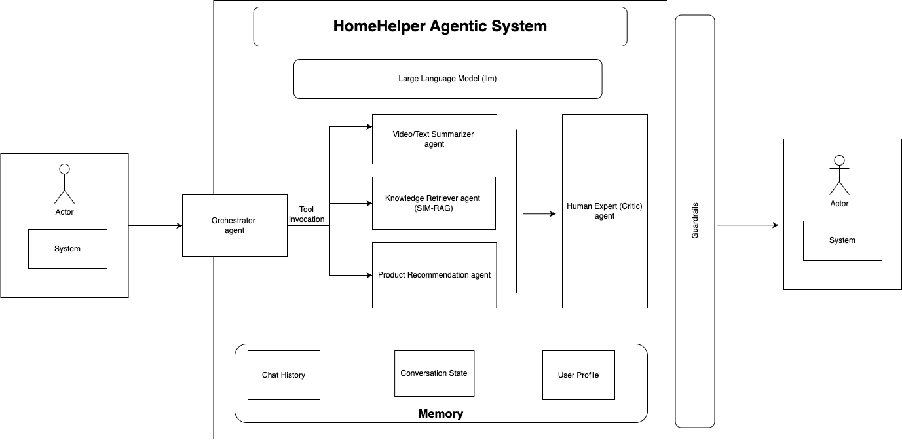

# 🧠 HomeHelper

> An AI-powered assistant to help troubleshoot and repair household appliances using a multi-agent system.

## 🌟 Overview

HomeHelper is a modular and extensible multi-agent framework designed to diagnose and provide solutions for common appliance problems. Users can interact with the system using text, images, or videos to get step-by-step repair guidance and relevant product recommendations.

Features include:

* ✅ **Multimodal Diagnostics:** Accepts text, image, and video inputs to understand the user's problem.

* ✅ **Intelligent Troubleshooting:** Employs a multi-agent system to analyze issues, retrieve knowledge, and formulate repair steps.

* ✅ **RAG and Product Recommendations:** Utilizes Retrieval-Augmented Generation to pull information from product manuals and suggests relevant products or parts.


----


----
## Architecture



----
## 📦 Installation

### 🔧 Prerequisites

* Python >= 3.9

* Ollama

* `ffmpeg` (for video processing)

### ⚙️ Setup

Clone the repo:

```
# Replace with your actual repository URL
git clone [https://github.com/yourusername/homehelper.git](https://github.com/yourusername/homehelper.git)
cd homehelper

```

Install dependencies:

```
pip install -r requirements.txt

```

Set up a virtual environment (recommended):

```
# Using conda
conda create -n homehelper-env python=3.10
conda activate homehelper-env
pip install -r requirements.txt

```

### 🤖 Ollama Setup

HomeHelper relies on locally-run language models via Ollama.

1. **Install Ollama:** Download and install from the [official website](https://ollama.com/download). For Linux, you can use:

   ```
   curl -fsSL [https://ollama.com/install.sh](https://ollama.com/install.sh) | sh
   
   ```

2. **Start the Ollama Server:**

   ```
   ollama serve
   
   ```

3. **Pull Required Models:**

   ```
   ollama pull gemma3
   ollama pull qwq
   ollama pull mistral:7b
   ollama pull llama3.2:3b
   ollama pull nomic-embed-text
   
   ```

## 🚀 Getting Started

### Run the Application

Start the FastAPI server:

```
python main.py

```

Expected output:

```
INFO:     Started server process [12345]
INFO:     Waiting for application startup.
INFO:     Application startup complete.
INFO:     Uvicorn running on [http://127.0.0.1:8006](http://127.0.0.1:8006) (Press CTRL+C to quit)

```

You can now access the HomeHelper interface at **http://localhost:8006**.

## 📁 Project Structure

```
homehelper/
├── systems/              # Core logic with agent systems (Orchestrator, Expert, Vision, etc.)
│   ├── agents/           # Agent classes (RAG, Critic, VisionAgent, etc.)
│   │   ├── memory/       # State definition for agents
│   │   └── tools/        # Reusable tools for agents (web search, retrieval)
├── templates/            # HTML templates for the web interface
├── static/               # CSS and JS files
├── resources/            # Helper scripts and data (e.g., training data generation)
├── ProcessedProducts/    # Stored product manuals and documentation
├── tests/                # Unit and integration tests
├── main.py               # FastAPI server entry point
├── run_agent.py          # CLI runner for the agent
├── requirements.txt      # Python dependencies
└── README.md

```

## 🧪 Running Tests

Run a specific test module with:

```
python -m tests.test_KnowledgeRetrieverSystem

```

To run all tests, you can use pytest:

```
pytest tests/

```

## 📬 Contact

For questions or collaboration, please open an issue on the GitHub repository

